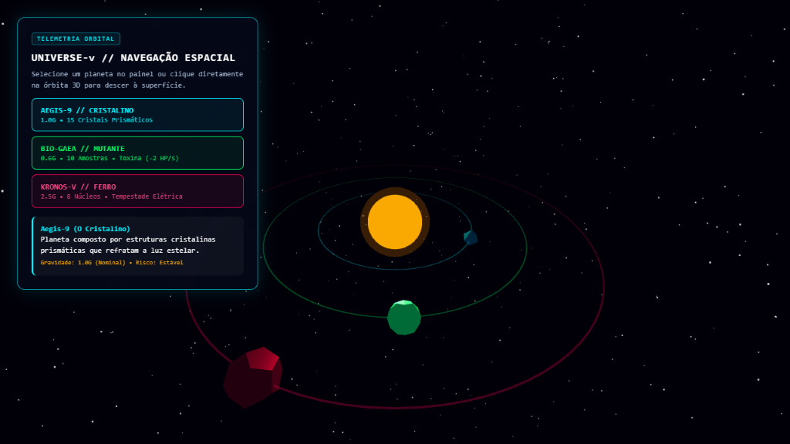
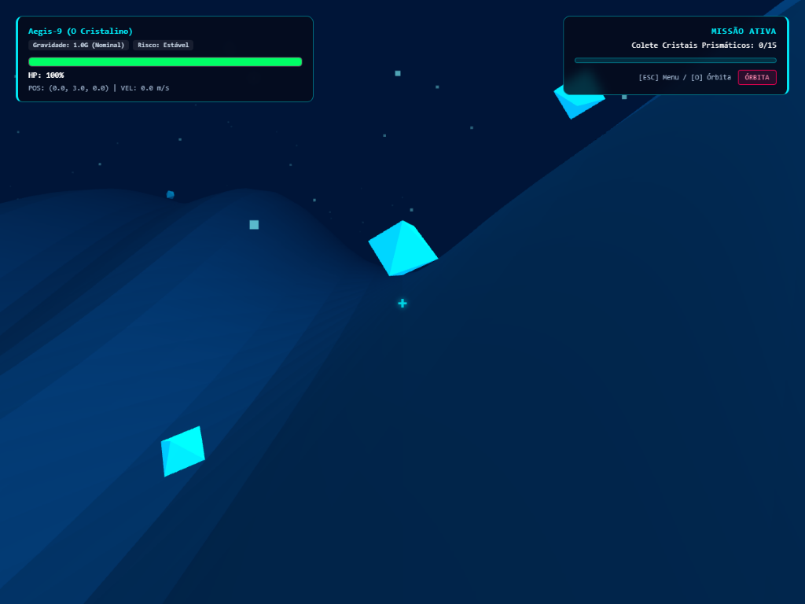
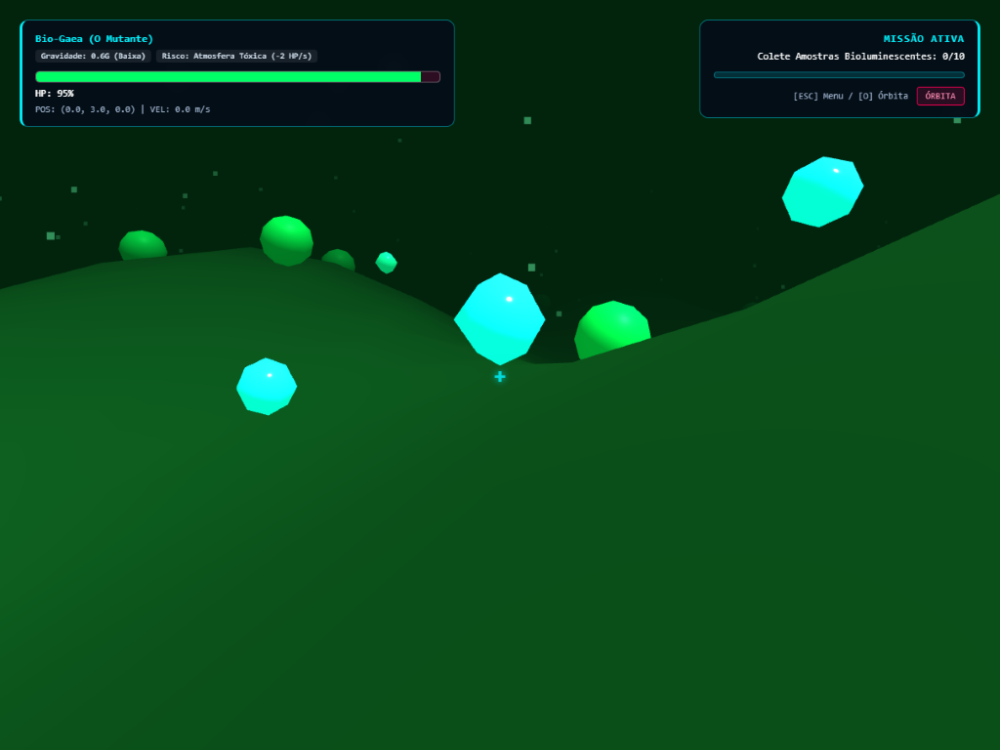
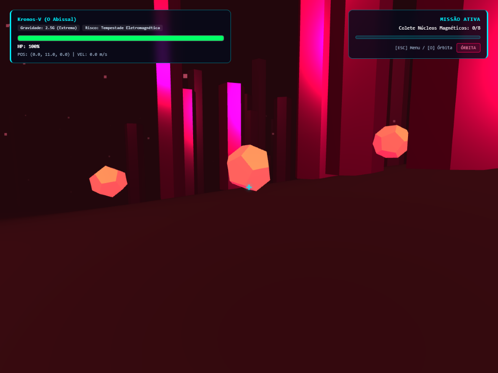

# Universe-v // FPS Planetary Explorer


Explorador espacial 3D interativo construído com **JavaScript (ES6+ / ES Modules)**, **Three.js (WebGL)**, **HTML5** e **CSS3**. Navegue por um sistema solar em órbita, selecione mundos diretamente pelo HUD ou clicando nos planetas em 3D e pouse na superfície para explorar em primeira pessoa (FPS) com gravidade diferenciada, riscos ambientais, coleta de itens e telemetria em tempo real.

---

## 💻 Linguagens e Tecnologias Principais

| Linguagem / Tecnologia | Papel no Projeto | Destaques Técnicos |
| :--- | :--- | :--- |
| **JavaScript (ES6+ / ES Modules)** | **Linguagem principal (~84% do código)** | Arquitetura modular orientada a objetos (`GameEngine`, `GameManager`, `PlayerController`, `PlanetFactory` e classes planetárias), física de gravidade/colisão por Raycasting e suíte de testes automatizados (`node:test`). |
| **Three.js / WebGL** | **Motor gráfico 3D** | Renderização em tempo real de terrenos procedurais, iluminação dinâmica, partículas atmosféricas (`THREE.Points`), anéis orbitais e controle de câmera em 1ª pessoa (`PointerLockControls`). |
| **CSS3** | **Interface e HUD Sci-Fi (~11% do código)** | Painéis translúcidos com `backdrop-filter: blur()`, variáveis CSS neon, barras dinâmicas de HP/progresso e layout responsivo. |
| **HTML5** | **Estrutura e Importmap (~5% do código)** | Estrutura semântica dos overlays (`#hud-orbit`, `#blocker`, `#fps-hud`) e resolução nativa de módulos via `<script type="importmap">`. |

---

## 📸 Screenshots

### Navegação Orbital 3D


### Aegis-9 (O Cristalino) — Exploração FPS


### Bio-Gaea (O Mutante) — Atmosfera Tóxica e Esporos


### Kronos-V (O Abissal) — Pilares de Basalto e Tempestade Magnética


---

## 🪐 Sistemas Planetários

| Planeta | Bioma | Gravidade | Risco Atmosférico | Missão de Coleta |
| :--- | :--- | :--- | :--- | :--- |
| **Aegis-9 (O Cristalino)** | Terreno prismático metálico-cristalino | `1.0G` (Nominal) | Estável | `15` Cristais Prismáticos |
| **Bio-Gaea (O Mutante)** | Biosfera orgânica com esporos pulsantes | `0.6G` (Baixa) | Atmosfera Tóxica (`-2 HP/s`) | `10` Amostras Bioluminescentes (`+15 HP` por coleta) |
| **Kronos-V (O Abissal)** | Dunas metálicas e pilares hexagonais de basalto | `2.5G` (Extrema) | Tempestade Eletromagnética | `8` Núcleos Magnéticos (`+10 HP` por coleta) |

---

## 🎮 Controles e Comandos

### Modo Órbita
- **Clique no painel lateral** (`Aegis-9`, `Bio-Gaea`, `Kronos-V`) ou **clique diretamente em um planeta na órbita 3D** para iniciar a descida.
- **Hover / Foco nos botões**: exibe detalhes de bioma, gravidade e risco no painel de preview orbital.

### Modo Superfície (1ª Pessoa)
- `W` `A` `S` `D` ou **Setas**: movimentação na superfície
- `Shift`: correr (sprint)
- `Espaço`: pular (altura ajustada automaticamente à gravidade do planeta)
- **Mouse** (com Pointer Lock ativo): rotacionar câmera em 360°
- `ESC`: pausar e abrir o menu de pouso
- `O` ou botão **Órbita**: retornar à navegação espacial

---

## 🏗️ Arquitetura e Estrutura de Pastas

```text
universe-v/
├── index.html                          # Estrutura principal, importmap Three.js e HUDs
├── package.json                        # Scripts de servidor local e testes automatizados
├── README.md                           # Documentação e capturas de tela
├── assets/
│   ├── css/
│   │   └── style.css                   # Estilização Sci-Fi / Neon, HUD FPS e responsividade
│   ├── js/
│   │   ├── main.js                     # Inicialização da aplicação e eventos de UI
│   │   ├── core/
│   │   │   ├── GameEngine.js           # Motor Three.js, órbita 3D, transições e loop principal
│   │   │   └── GameManager.js          # Estado da missão, HP, protocolo de emergência e HUD
│   │   ├── controls/
│   │   │   └── PlayerController.js     # Controles FPS, Pointer Lock, gravidade, colisão e telemetria
│   │   ├── components/
│   │   │   ├── PlanetFactory.js        # Definições visuais e orbitais dos planetas
│   │   │   └── SurfaceExplorer.js      # Componente legado de exploração superficial
│   │   └── planets/
│   │       ├── PlanetAegis.js          # Terreno, partículas e cristais de Aegis-9
│   │       ├── PlanetGaea.js           # Terreno, esporos pulsantes, toxina e amostras de Bio-Gaea
│   │       └── PlanetKronos.js         # Terreno, pilares de basalto, relâmpagos e núcleos de Kronos-V
│   └── screenshots/
│       ├── orbit-navigation.png
│       ├── planet-aegis.png
│       ├── planet-gaea.png
│       └── planet-kronos.png
└── tests/
    └── universe.test.js                # Suíte de testes automatizados com node:test
```

---

## 🚀 Como Executar Localmente

Como o projeto utiliza **ES Modules**, é necessário servi-lo via servidor HTTP local:

```bash
# Usando npm (Python HTTP server na porta 8080)
npm start
```

Ou diretamente com Python:

```bash
python -m http.server 8080
```

Depois, acesse `http://localhost:8080` no navegador.

---

## 🧪 Testes Automatizados

O projeto conta com suíte de testes unitários e estruturais usando o runner nativo do Node.js (`node:test`):

```bash
npm test
```

Os testes cobrem:
- Ciclo de vida e configuração do `GameManager` para todos os planetas (`Aegis`, `Gaea`, `Kronos`);
- Coleta de itens, conclusão de missão, dano atmosférico contínuo, cura e protocolo de emergência ao zerar HP;
- Sincronização de barras, textos e estilos no HUD (`updateHUD`);
- Funções determinísticas de relevo (`getTerrainHeight`), espaçamento de pouso seguro em `Kronos-V` e `reset()` dos planetas;
- Integridade dos IDs de interface e `importmap` em `index.html` e integridade sintática de `assets/css/style.css`.
